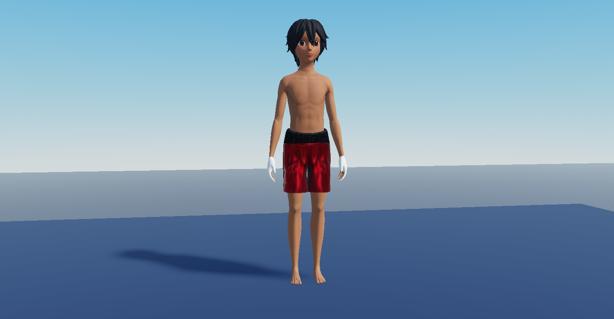
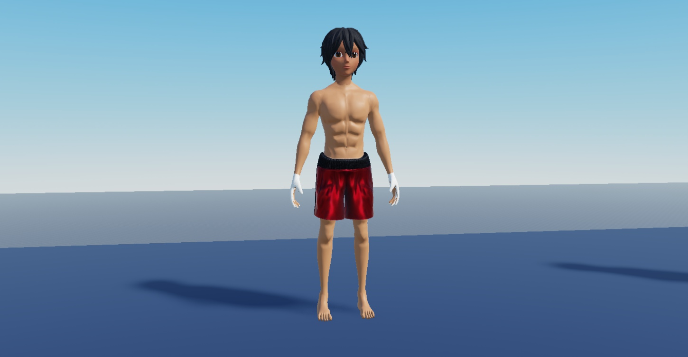
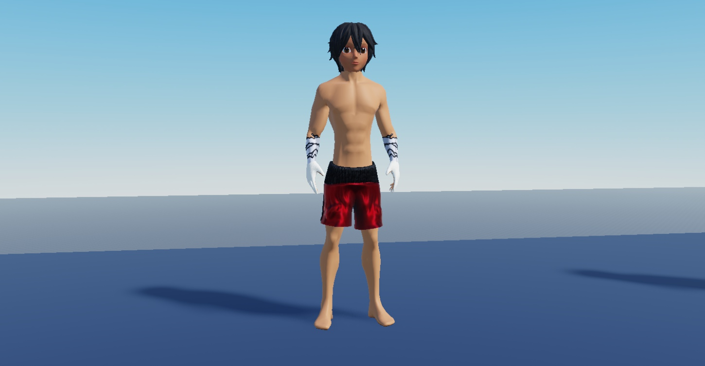
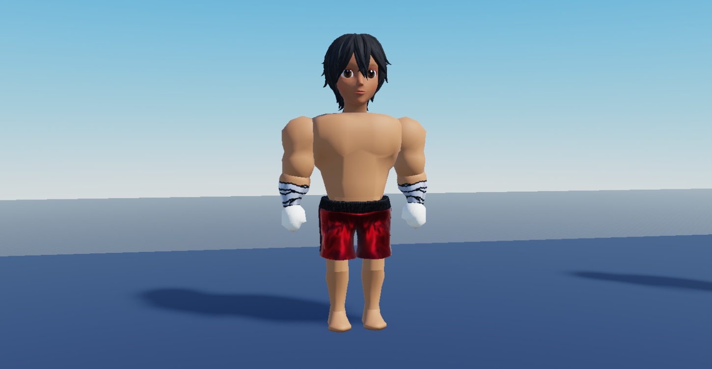

# Fase 2 — Parte A: elegir cuerpo

Propuesta del 2026-11-28. **Pendiente de elección del dueño; no implementar Parte B todavía.** Capturas reales del placeId `111090309292395`, no renders generados. El código del juego no cambió.

## Cuatro opciones probadas

Se cargaron con `AssetService:GetBundleDetailsAsync` y `Players:CreateHumanoidModelFromDescriptionAsync`, usando las piezas de cuerpo en un HumanoidDescription nuevo. Para comparar siluetas, comparten piel, cabeza/cara Glenn, cabello negro y shorts rojos. Las manos llevan una cobertura blanca de malla provisional; el Shirt de vendas no se dibuja igual en todos los paquetes. Tenis, variantes de cara/cabello y vendas definitivas se ajustan después de elegir.

| Opción | Cuerpo del catálogo | Lectura visual | Escala de la captura: ancho / profundidad / altura / tipo / proporción |
|---|---|---|---|
| A | [Glenn — Roblox, bundle 984](https://www.roblox.com/bundles/984) | Delgado, juvenil, estilo anime; buen inicio de progresión. | 0.90 / 0.90 / 1.00 / 1.00 / 0 |
| B | [Athletic Muscle Man — Inf1n1tylt, bundle 594501](https://www.roblox.com/bundles/594501) | Músculos y abdominales muy definidos, proporciones humanas estilizadas. Mi recomendación como referencia del boxeador entrenado. | 0.90 / 0.90 / 1.00 / 1.00 / 0 |
| C | [Athletic Muscle Body — adidas, bundle 98889867899884](https://www.roblox.com/bundles/98889867899884) | Atlético, musculatura más suave y torso estrecho; alternativa menos exagerada. | 0.90 / 0.90 / 1.00 / 1.00 / 0 |
| D | [Superhero — Roblox, bundle 299](https://www.roblox.com/bundles/299) | Pecho/hombros grandes y brazos voluminosos; más caricaturesco. | 0.90 / 0.90 / 1.00 / 0.30 / 0 |

### A — Glenn

### B — Athletic Muscle Man

### C — Athletic Muscle Body (adidas)

### D — Superhero

## Propuesta de progresión, aún sin aprobar

Se mantienen los umbrales ya aprobados del promedio de stats. Cada fila usa un cuerpo distinto; cambiaría solo el cuerpo, conservando la identidad de cabeza/cara/cabello elegida por el jugador. Las escalas son punto de partida para ajustar tras la elección, no balance implementado.

| Nivel | Promedio mínimo | Cuerpo propuesto | Ancho | Profundidad | Altura | BodyType | Proportion |
|---|---:|---|---:|---:|---:|---:|---:|
| Flaco | 1 | A: Glenn (984) | 0.80 | 0.85 | 0.95 | 1.00 | 0.10 |
| Atlético | 25 | C: Athletic Muscle Body (98889867899884) | 0.90 | 0.90 | 1.00 | 1.00 | 0 |
| Marcado | 75 | B: Athletic Muscle Man (594501) | 0.95 | 0.95 | 1.00 | 1.00 | 0 |
| Musculoso | 150 | D: Superhero (299) | 1.00 | 1.00 | 1.02 | 0.30 | 0 |
| Bestia | 300 | [Strong Muscle Man — imHalfY (115720883611504)](https://www.roblox.com/bundles/115720883611504) | 1.05 | 1.05 | 1.04 | 1.00 | 0 |

**Bestia es una quinta propuesta por verificar visualmente:** se consultó su ficha y piezas, pero no forma parte de las cuatro capturas ni se ha aprobado. HeadScale = 1 en toda la propuesta. Mezclar estos cuerpos cambia también el estilo anatómico; el dueño puede elegir una referencia y pedir que se ajuste la progresión a esa familia antes de implementarla.

## Receta y observaciones técnicas

- Cabeza común: Glenn `11572085825`; cabello `11599969557`. A conserva además cejas/pestañas del bundle. No se cambió ninguna apariencia guardada.
- Shorts de catálogo: Red Boxing Shorts, `9726891755`, `AccessoryType.Shorts`, `Order=1`, `IsLayered=true`, mediante `HumanoidDescription:SetAccessories`.
- Shirt de vendas consultado/cargado: `4554120891`. Su mapeo no se ve en A/B igual que en C/D; para comparar, se añadieron coberturas blancas de la malla de cada mano (escala 1.045), exclusivamente en los maniquíes temporales. No son la solución final de Parte B.
- Todas las piezas del cuerpo provienen de los bundles enlazados. `BodyTypeScale` y `ProportionScale` no son equivalentes a ancho/profundidad; referencias: [HumanoidDescription](https://create.roblox.com/docs/reference/engine/classes/HumanoidDescription).
- Studio actual genera `AnimationConstraint` y accesorios con welds en sentido Handle→cuerpo. Para la pose estática en Edit se ensambló el grafo desde HumanoidRootPart, respetando ambos sentidos del joint, sin modificar las RigAttachments. Parte B debe usar Animator/KeyframeSequence compatibles con este rig.
- Se descartaron Oliver (573: chaqueta integrada), Action Figure (308: deformación de shorts) y Man (238: silueta demasiado cuadrada). No son opciones finales.
- Dos revisiones de montaje/captura se detuvieron al trabarse (menos de 1 min y 61 s); una comprobación en Play se cortó a los 72 s porque el visor salía negro. El dueño puso Studio al frente y las capturas funcionaron. La revisión final tomó 98 s incluyendo retirada de modelos. No se reintentó un Play largo.
- Al terminar se retiraron escenario/maniquíes temporales y la sonda Rojo; se restauraron cámara/FOV. No se guardó/publicó el lugar ni se crearon copias. Studio quedó en Edit.

## Rojo

El log de Studio registra `ConnectFail`/`Couldn't connect to the Rojo server` contra `localhost:34872` durante la sesión anterior. El servidor actual escucha en `127.0.0.1:34872`; tanto esa URL como localhost respondieron HTTP 200 desde terminal. Después de que el dueño conectara el plugin usando **127.0.0.1**, se observó conexión TCP establecida y sincronización real: un StringValue temporal definido en el repo apareció en Studio y desapareció al retirar el archivo. No fue necesario instalar scripts por MCP esta vez. Esto confirma la conexión corregida; el log no demuestra por sí solo la causa de red del fallo anterior.

## Siguiente paso

El dueño elige **A, B, C o D**, y confirma o ajusta la progresión propuesta. Solo entonces comienza Parte B: sustituir BoxerRig, conservar elecciones persistidas con opciones compatibles, crear seis KeyframeSequence, validarlas en Studio y preparar `SUBIR_ANIMACIONES.md`. No se cambiaron aún rig ni animaciones de producción.
