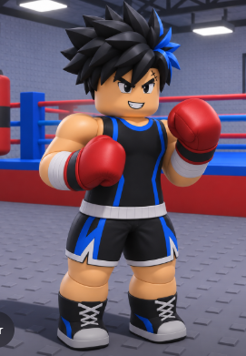
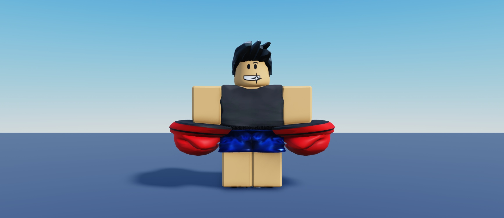
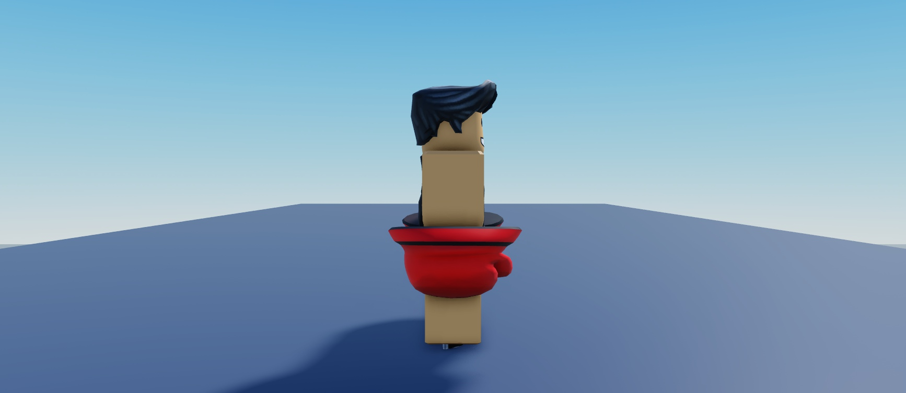
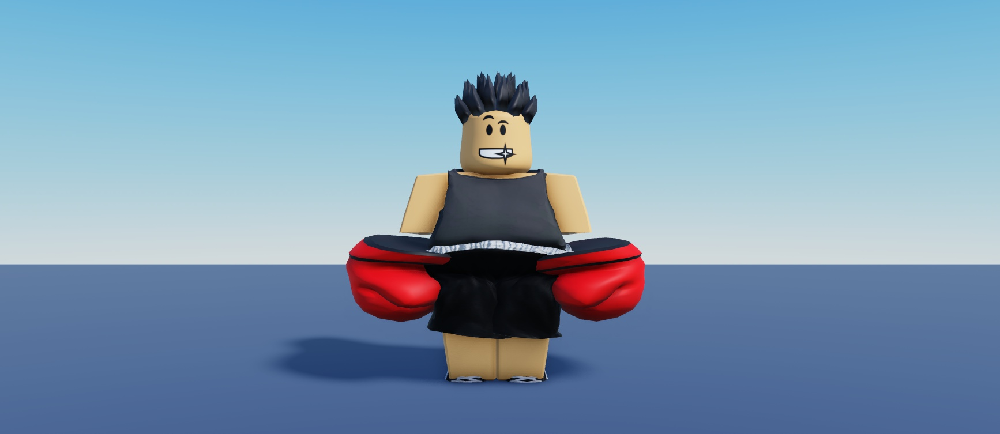
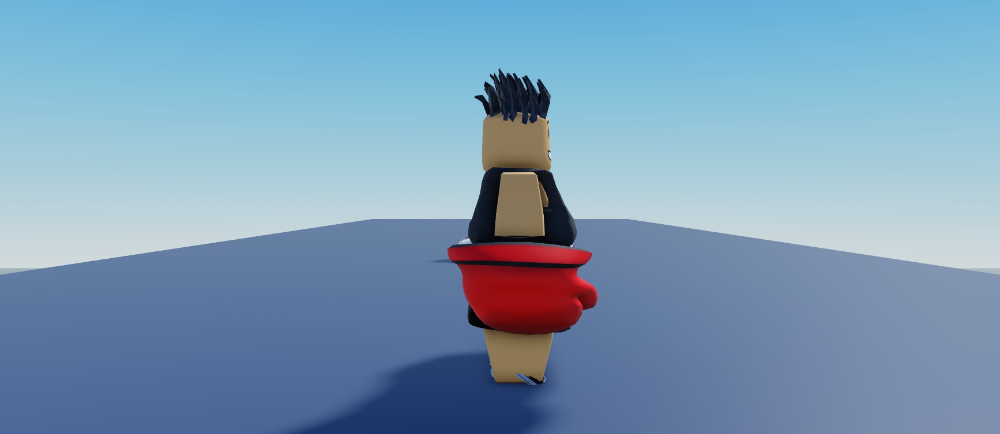
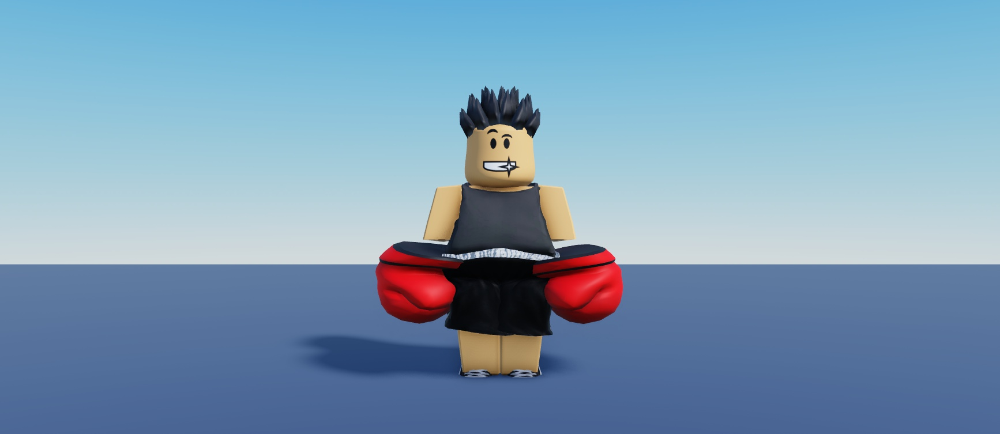
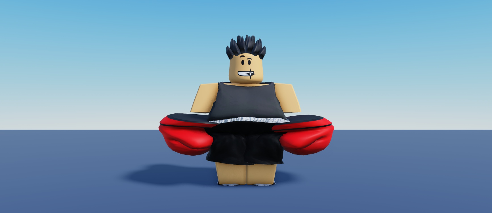

# Boxeador: comparación del estilo definitivo

Revisión del 2026-11-28, solo Parte A. A–D quedan descartadas. **Ninguna variante está aprobada ni terminada: falta resolver los tenis y acercar los detalles de ropa a la referencia. Parte B no iniciada.**

[Abrir comparación visual grande: referencia, frente y lado](referencias/estilo-final/comparacion.html).

## Dos variantes reales en Studio

Capturas sin retoque del placeId `111090309292395`. Modelos R15 creados con HumanoidDescription; no son imágenes generadas. Se retiraron al terminar, sin guardar/publicar el lugar. Pose neutra para comparar siluetas, todavía sin guardia nueva.

| Referencia | V1: clásico suavizado, frente | V1: lado |
|---|---|---|
|  |  |  |

| Referencia | V2: corto redondeado, frente | V2: lado |
|---|---|---|
|  |  |  |

- **V1:** [Smooth Blocky 1.0](https://www.roblox.com/bundles/106693702694098), **DuckXander, tercero**. Ancho/profundidad/alto `1 / 1 / 0.85`. Conserva hombros rectos y extremidades más cuadradas; el redondeado es discreto. Pelo Black Spiky Hair, shorts azules.
- **V2:** [Short Round Blocky](https://www.roblox.com/bundles/6299525098196), **Clockset's Crazy UGC Creations, tercero**. Escalas `1 / 1 / 0.90`. Silueta más pequeña, torso y piernas inclinados/redondeados. Pelo Midnight Flash Anime Hair, shorts negros. Es mi candidato más cercano de los dos, pero la camiseta abulta en el abdomen.
- Ambas: cabeza [Cheeks/Descarado 746767604](https://www.roblox.com/catalog/746767604) y cara Shiny Teeth de **Roblox**. HeadScale `1`, BodyTypeScale y ProportionScale `0`; piel RGB `235,173,105`.

**Diferencias pendientes:** no se logró el acabado de la ilustración. Los tenis altos se deforman con las capas y el intento de montaje rígido los dejó parcialmente ocultos; las capturas muestran ese fallo. Los guantes tienen puños demasiado abiertos y crecen mucho con Bestia. Faltan ribetes azules, ajuste más ceñido de camiseta y expresión de ojos más próxima al dibujo. No dar esta combinación por lista para producción.

## Artículos, autoría y respaldo

Consultados mediante MarketplaceService/AvatarEditorService/AssetService el 2026-11-28. Las fichas verifican identidad y autoría, no garantizan carga futura ni compatibilidad visual. No se compraron artículos.

| Uso | Artículo principal | Creador | Respaldo propuesto y estado |
|---|---|---|---|
| Cuerpo V1/V2 | Bundles anteriores | **Terceros** | Entre sí; emergencia [ROBLOX Boy 109](https://www.roblox.com/bundles/109), **Roblox**, cambia la silueta y requiere revisión |
| Cabeza | [746767604](https://www.roblox.com/catalog/746767604) | Roblox | Cabeza R15 estándar con cara básica; verificar conversión a cabeza dinámica antes de implementar |
| Camiseta sin mangas | [Tank Top Gray 11600029136](https://www.roblox.com/catalog/11600029136) | Roblox | Ropa clásica propia del repo en una futura implementación; todavía no creada |
| Guantes grandes rojos | [Oversized Boxing Gloves 12333060095](https://www.roblox.com/catalog/12333060095) | **Dev_R0VER, tercero** | [Red Boxing Gloves 11977911408](https://www.roblox.com/catalog/11977911408), **Dockery, tercero**; cargaron, peor ajuste en esta revisión |
| Shorts | Negro/azul/rojo/blanco, tabla inferior | **Dockery, tercero** | [Shorts Gray 11600040895](https://www.roblox.com/catalog/11600040895), Roblox; ficha consultada, ajuste pendiente |
| Tenis altos con calcetines | [Izquierdo 85415418011919](https://www.roblox.com/catalog/85415418011919), [derecho 82907354089354](https://www.roblox.com/catalog/82907354089354) | **Chrome Kitty, tercero** | [Sneakers Gray, bundle 872](https://www.roblox.com/bundles/872), Roblox: `7193165925 / 7193166879`; también se deformaron, **respaldo visual no validado** |
| Otro par probado | `109327049739669 / 99148738190585`, Black High Canvas Sneaker | **vstar*, tercero** | También falló el ajuste por capas; no recomendado todavía |

Respaldo técnico propuesto para Parte B: cargar con `pcall`, intentar una alternativa por categoría y conservar la selección lógica guardada aunque temporalmente no cargue un artículo. Si fallan ambos, usar base R15 y ropa propia del juego; no sobrescribir la apariencia persistida. **No hay fallback implementado en esta Parte A.** Dos artículos del mismo creador no constituyen un respaldo independiente. No se descargaron ni redistribuyeron mallas ajenas.

Las camisetas clásicas `106730127467199` (再生の風景) y `11204723229` (TherealKevin2099), ambas de terceros, se descartaron de las capturas finales: pintaban mangas/franjas o músculos ajenos al estilo. El cabello negro/azul largo también tapaba demasiado la cara.

## Físico: mismo cuerpo, cinco escalas

Propuesta sobre **V2**, sin cambiar malla entre niveles. Umbrales de promedio de los cuatro stats ya autorizados: `1 / 25 / 75 / 150 / 300`. Las escalas son propuesta visual, no balance implementado.

| Nivel | Promedio mínimo | WidthScale | DepthScale | HeightScale | HeadScale |
|---|---:|---:|---:|---:|---:|
| Flaco | 1 | 0.82 | 0.85 | 0.85 | 1 |
| Atlético | 25 | 0.94 | 0.94 | 0.86 | 1 |
| Marcado | 75 | 1.00 | 1.00 | 0.87 | 1 |
| Musculoso | 150 | 1.10 | 1.08 | 0.89 | 1 |
| Bestia | 300 | 1.20 | 1.15 | 0.92 | 1 |

| Flaco | Bestia |
|---|---|
|  |  |

Misma cámara: FOV 35, distancia 12 studs. Se nota la anchura de torso/extremidades, manteniendo cabeza grande y poca ganancia en altura. Capturas de modelos temporales, **no crecimiento por stats del jugador**. Ropa/guantes también se ensanchan: hace falta limitar su volumen al resolver el ajuste. Los niveles intermedios solo están propuestos; no se fotografiaron.

## Creador: cuatro caras

Todas de **Roblox**. Solo Shiny Teeth se probó puesta en la cabeza elegida; las otras tres tienen ficha verificada y requieren prueba visual.

| Opción | Catálogo | Respaldo |
|---|---|---|
| Dientes brillantes / Shiny Teeth | [20722130](https://www.roblox.com/catalog/20722130) | Sonrisa básica del juego |
| Risa tonta / Silly Fun | [7699174](https://www.roblox.com/catalog/7699174) | Shiny Teeth |
| Tranqui / Chill | [7074764](https://www.roblox.com/catalog/7074764) | Shiny Teeth |
| Sonrisa vencedora / Winning Smile | [616380929](https://www.roblox.com/catalog/616380929) | Shiny Teeth |

## Creador: seis peinados

| Opción | Catálogo | Creador | Revisión / respaldo |
|---|---|---|---|
| Midnight Flash Anime Hair | [15364595](https://www.roblox.com/catalog/15364595) | Roblox | Visible V2; principal recomendado |
| Black Spiky Hair | [3814450142](https://www.roblox.com/catalog/3814450142) | Roblox | Visible V1; respaldo del anterior |
| Black Spiky Anime Hair | [7963401282](https://www.roblox.com/catalog/7963401282) | **ICENODE, tercero** | Cargó; flequillo tapa ojos. Respaldo 15364595 |
| Black Blue Spiky Anime Hair | [85512507380840](https://www.roblox.com/catalog/85512507380840) | **DIDIgamedev, tercero** | Cargó; demasiado largo para esta cara. Respaldo 15364595 |
| Red Spiky Anime Hair | [8030528948](https://www.roblox.com/catalog/8030528948) | **ICENODE, tercero** | Ficha verificada, ajuste pendiente. Respaldo 3814450142; se pierde el rojo |
| Super Spiky Anime Hair White | [14282316652](https://www.roblox.com/catalog/14282316652) | **monsoon apparel, tercero** | Ficha verificada, ajuste pendiente. Respaldo 15364595; se pierde el blanco |

## Cuatro colores de ropa

Camiseta gris/negra común y guantes rojos; elegir color de shorts. No se promete recolorear texturas ajenas ni combinar aún los ribetes de todo el conjunto.

| Color | Shorts del catálogo, todos **Dockery (tercero)** | Estado |
|---|---|---|
| Negro | [9726894557](https://www.roblox.com/catalog/9726894557) | Captura V2 |
| Azul | [9726887631](https://www.roblox.com/catalog/9726887631) | Captura V1 |
| Rojo | [9726891755](https://www.roblox.com/catalog/9726891755) | Ficha verificada |
| Blanco | [9726900805](https://www.roblox.com/catalog/9726900805) | Ficha verificada |

Respaldo común: Shorts Gray de Roblox, aceptando cambio temporal de color sin cambiar la elección guardada. Para reproducir los acentos exactos del dibujo se necesitará ropa compatible adicional o textura propia; no se ha creado/subido ninguna.

## Resultado de la revisión

Dos revisiones Play de 81 s y 54 s. Carga R15, cara y comparación de escalas observadas; ajuste de calzado **fallido**. Captura inicial negra en Edit: detenida y retomada cuando el dueño trajo Studio al frente. Modelos temporales retirados; cámara restaurada, Studio en Edit. No hubo cambios intencionales en stats/apariencia del jugador, scripts, minijuegos ni animaciones. La fase sigue abierta: resolver calzado/ropa y recibir aprobación visual antes de Parte B.
