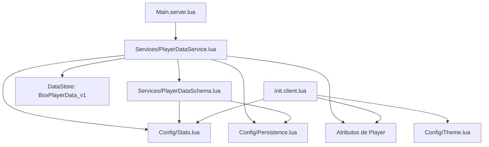

# Mapa del código — Fase 1

Actualizado el 2026-11-26 por [codex]. **Mapa manual, no generado por Graphify.** La herramienta no estaba disponible y se interrumpió su instalación temporal al atascarse la resolución de dependencias. La extracción automática queda pendiente; no existen graph.json/graph.html generados.

- `PlayerDataService`: ciclo de vida del jugador, sesiones, carga, bloqueo, guardados, API solo servidor y publicación de atributos.
- `PlayerDataSchema`: creación de datos iniciales y validación estricta del registro; rechaza versiones incompatibles sin sobrescribirlas.
- `Stats`: nombres, valores iniciales y topes aprobados de los tres rangos.
- `Persistence`: nombre del almacén, versión, tiempos y reintentos.
- `Theme`: fuente, colores, tamaños y espaciado del HUD.
- `init.client.lua`: crea el HUD y escucha atributos; no escribe datos ni llama remotos.
- `tools/check-data.cjs` + `tools/check-data.lua`: validación sintáctica y escenarios aislados con DataStore simulado. No sincronizados a Studio.
- `Config/Game.lua`: configuración general preexistente, todavía sin consumidor.

Entrada Rojo: `default.project.json`. Datos fluyen servidor → atributos → HUD. El guardado lee exclusivamente la memoria del servicio. No hay gym, combate ni ascensos implementados.
